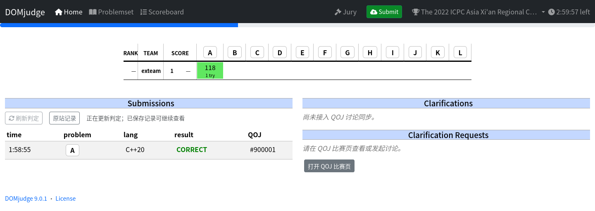
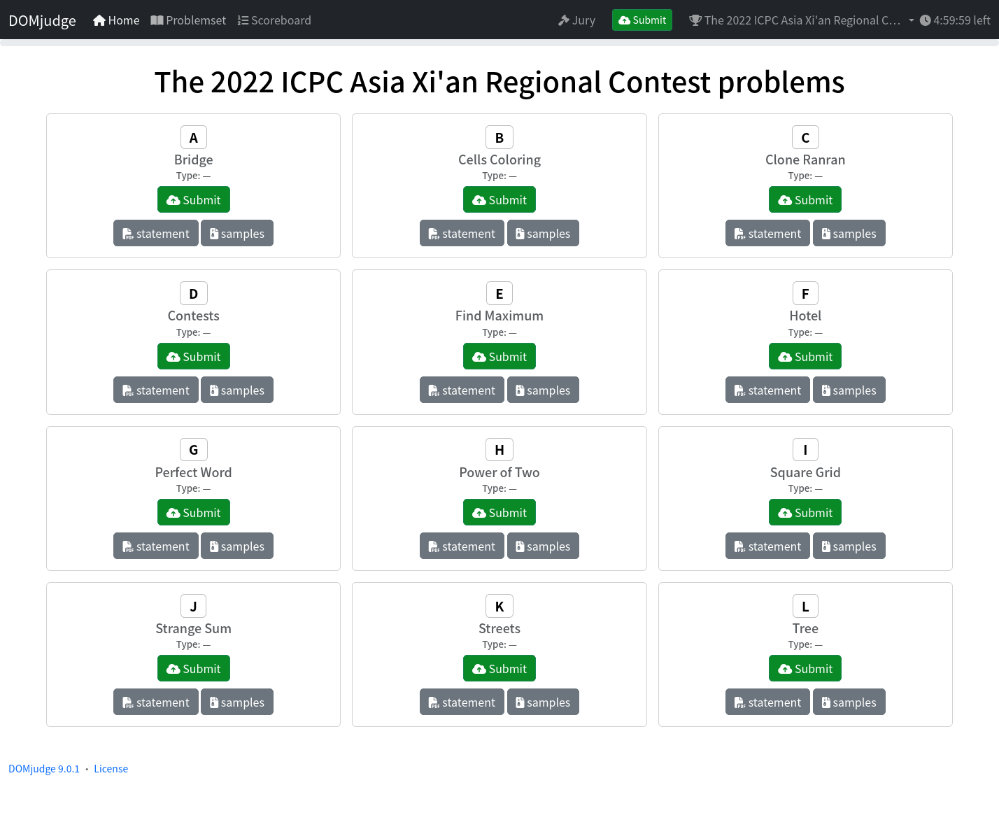

# QOJ Workbench

在 Firefox 中用 DOMjudge 风格的界面打 QOJ：提交代码、查看判定、下载样例和附件。

**[下载安装](https://github.com/LittleDrinks/qoj-vp/releases/latest)** · [反馈问题](https://github.com/LittleDrinks/qoj-vp/issues)

唯一支持和验收环境：**Hydro Contest OS 2026**。安装步骤见下载页面。

Problemset：题面、样例与提交入口

## 使用

1. 在 Firefox 登录 QOJ，进入比赛的 VP 确认页，点击 **准备比赛文件并打开工作台**。
2. 准备完成后，点击 QOJ 原站 **Start!**；工作台自动采用 QOJ 的开始时间。
3. 在 **Home** 提交和查看判定，在 **Problemset** 打开题面、下载样例或附件。
4. 比赛配置、手动添加样例、归档和删除放在 **Jury**。

助手只在需要时运行，不用手动开启后台服务。关闭页面后，比赛记录和已准备的文件仍保留。

## 许可证

[GPL-2.0-or-later](LICENSE)。DOMjudge 界面与其他依赖保留各自的[来源及许可证](src/firefox/assets/licenses)。

本地 Board 的算榜与标准渲染继续使用固定提交的 MIT 组件 `standard-ranklist-utils` / `standard-ranklist-renderer-component`。完整榜单页通过 `vendor/rankland-web` 子模块直接复用 [`rankland-web` 展示层](https://github.com/algoux/rankland-web/tree/3bf66be459ac67326a2f488f2f0071f1d36ce18c/src/client/components/ranklist)的设置、虚拟窗口、列宽和样式源码（固定 ref `3bf66be459ac67326a2f488f2f0071f1d36ce18c`），并以 React 薄适配接入本地数据；同时核对了 `vp.xcpc.link` 实际页面的只读行为。该仓库是主站展示源码，并非 VP 应用的完整公开源码，且在核查时未提供明确的 LICENSE，因此不声称其采用 MIT；插件不引入主站服务、SSR 或账号系统，新增适配代码遵循本仓库许可证。
