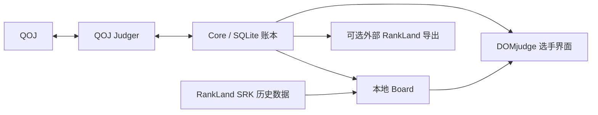

# Judger / Core / Board

状态：2026-11-04 已确定的目标架构；实现仍在开发中，尚未发布。下述新模块和构建命令随重构代码交付，当前安装以 Release 为准。



## 边界

| 模块 | 职责 | 入口 |
|---|---|---|
| Judger | 接收提交、获取题表/样例、核实时间与判定、核对丢失回执 | `qojvp/judgers/qoj.py: execute(action,args,exchange)` |
| Core | 比赛生命周期、持久记录、缓存快照、未完成评测调度 | `qojvp/application.py`, `qojvp/ledger.py` |
| Board 数据源 | 读取公开 SRK 文件并校验、保存可替换的历史数据缓存 | `extension/scoreboard-sources.js`, `board/cache.js` |
| Board 计算 | 合并历史对手与本队时间线，输出同一份名次/罚时/题格 | `extension/board/engine.js: project(input,archive,elapsedMs)` |
| Board 服务 | 合并重复读取、数据失效时保留本队成绩、后台更新 | `extension/board/service.js: snapshot(sessionId)` |
| Board 展示 | 使用上游 React 榜单组件，数据本地渲染 | `extension/board/view.jsx` |

`judger.*` 是提供者动作接口；旧 `qoj_*` 保留兼容。已保存的 session 决定 Judger，调用者不能临时切换。
目前只注册 QOJ；增加提供者还需要其浏览器传输权限、身份/题号映射以及账本键的命名空间迁移，不能只换域名。

Python 助手仍按操作启动退出；本地榜单在 Firefox 运行，不引入 Node 后台或 HTTP 服务。

## 时间与一致性

- 比赛以 QOJ 核实的 VP 开始时间为基准，提交使用 QOJ 接收时间相对该起点的偏移。
- 判题晚五分钟仍记原提交时间。同题较早待判不算错题；结果补齐后整条时间线重算。此时成绩标记为待确认。
- 重判按提交 ID 替换事实；同一时刻的两个不同提交仍分别计数。
- 不确认的回执不重发源码；无法核实时间的历史不参与计分。
- 顶部本队行与完整榜单来自同一份 Board 结果。仅有最终汇总而没有完整提交历史的 SRK 不伪造成回放数据。
- Board 只读 `session_snapshot`，不触发 QOJ fetch。评测调度使用 `settlement_sessions`，不依赖外部榜单投递状态。
- 外部 RankLand 导出仍是显式兼容功能，其标签页、存储结构和回执不决定本地计分。
- 已有比赛不必删除：缺少 judger 的旧 session 默认 QOJ，旧榜单 URL 只用于兼容读取数据源/赛制。
- Jury 可指定 ICPC / CCPC26 / 数据源默认赛制；改变赛制只改变投影，不修改 QOJ 事实。外部导出沿用其单独 URL 配置。

## 上游复用与构建

三个 git submodule：`qoj-submitter`、`standard-ranklist-utils`、`standard-ranklist-renderer-component`。
固定提交用于可复现构建，并不要求线上 RankLand 网站固定版本。上游更新作为正常依赖升级验证。
浏览器不下载执行远程代码；utils 与 renderer 源码编译进扩展，保留 MIT 许可证及提交记录。

```sh
git submodule update --init --recursive
npm ci
npm run build:board
python3 -m venv .venv
.venv/bin/pip install -e .
.venv/bin/python -m unittest discover -s tests
node --test tests/*.cjs preflight/test_*.cjs
npm run lint:firefox
```

`npm run build:board` 直接编译固定子模块，避免 renderer 与计算端使用两份不同 utils。
源代码发布包携带子模块与构建产物；脱离 Git 重建时使用 `SOURCE_MANIFEST.json` 中的提交信息。

## 安装交付

唯一运行与验收目标是 Hydro Contest OS 2026（Ubuntu 24.04 amd64、Python 3.12、Firefox ESR）。
下一次签名发布生成 `.deb`，通过 apt 安装系统依赖，包含签名 XPI、完整对应源码和全局 Native Messaging 注册。
用户从应用菜单启动后，迁移旧连接配置、检查助手，再打开 Firefox 安装确认。助手每次任务结束即退出。
升级保留原有自定义状态目录；连接检查失败恢复旧注册。Release 正文只展示下载入口和一条 apt 安装命令。
wheel 与发布元数据保留在 CI artifact，公开下载区保留安装包、XPI 和校验文件。
