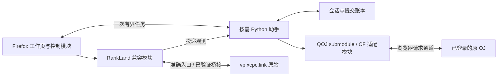

# Firefox VP 工作台：生命周期与模块分工建议

2026-10-31。设计方案，未实现产品、修改用户存储或操作真实 VP。基于[当前 RankLand 实现调研](./rankland-vp-lifecycle-research-2026-10-31.md)，不是把内部存储格式当成稳定公开接口。

## 建议

保留已经选定的形态：Firefox 工具栏打开完整扩展页面，展示复用的 DOMjudge Home/Submissions 和 Problemset；Python 通过 Native Messaging 按任务运行，结束便退出；现有 QOJ CLI 作为独立 submodule；CF/Gym 使用另一份平台适配模块。首版 Scoreboard 继续打开原版 vp.xcpc.link。

完善 VP 管理的重点是建立**独立于标签页的会话档案、提交事实和同步队列**。关闭页面只是关闭视图，不代表比赛暂停、提交撤回或档案删除。计时可以通过持久时间锚点恢复，不需要常驻 Python。

## 四个模块与少量接口

| 模块 | 职责 | 主要接口及约定 |
| --- | --- | --- |
| 会话与账本模块（Python） | 持久保存会话、提交尝试、原 OJ 观测和同步进度；导出恢复档案 | `inspect(sessionId)` 返回事实及待办；`commit(event, expectedVersion)` 原子、幂等地登记变化；`export(sessionId)` 产出版本化档案 |
| 平台适配模块（QOJ / CF/Gym） | 检查账号/比赛、取得题目与样例、提交、分页补查判定 | `inspectBinding`；`prepareSubmit`；`submit`；`listSubmissions(cursor)`。返回结构化事实和查询覆盖范围，不打印终端 UI，不决定 VP 生命周期 |
| RankLand 兼容模块（扩展） | 打开准确恢复入口、只读识别目标会话、记录投递证据；在已验证的版本上调用原站入口 | `inspectTarget`；`openResume`；`deliver`；`verifyDelivery`。每个写能力明确是否已验证，不把“找到页面”当成同步成功 |
| 扩展控制与视图模块 | 工具栏、工作页、短任务调度、浏览器登录与请求通道、状态展示 | 启动一次任务、订阅结果、读取待办计划；关闭 UI 只取消视图订阅。网络、计时、排名计算不散落到各页面 |

Native Messaging 是连接这些模块的传输方式，不再单独承载业务状态。需要浏览器登录态的 HTTP 请求由扩展的原站请求通道执行；QOJ 的 Python 解析与整理规则通过自定义 session 接口复用。现有 CLI 继续使用自己的 Python HTTP 实现。这个通道尚需验证，不能声称现有 CLI 已直接兼容。



界面的提交页、Problemset 和以后可能增加的 DOMjudge board 都读取同一套会话和提交事实。样例下载失败只影响该任务，RankLand 同步失败只影响同步，不阻塞提交。

## 事实保存在哪里

建议由按需助手在 **Firefox 所在系统的本机用户数据目录** 管理一份 SQLite 账本，例如 `$XDG_DATA_HOME/<项目名>/state.sqlite3`。它是本工作台会话、尝试、观测与投递记录的权威存档；原 OJ 仍是实际提交是否存在、何时提交、当前如何判定的权威来源。

- 扩展存储只保留视图缓存、用户偏好和最近会话索引；能帮助展示，不能静默覆盖较新的账本版本。
- RankLand localStorage 是原站的工作副本，备份时保留 raw key、raw value、origin、采集时间和来源版本。它不取代本工作台的来源关联和提交账本。
- 每次原子登记事务后才确认任务完成。导出档案包括会话、题目映射、提交观测、未完成尝试及同步状态，不包含 Cookie/密码。
- `E:\shared` 用来交换源码、安装产物和显式导出档案；运行中的账本放在虚拟机本地用户目录，避免多个系统把共享文件当成同一个活动状态库。
- Firefox 在虚拟机、CLI 在 WSL 或另一台机器时，它们是不同安装实例。共享文件夹不会自动共享会话或浏览器登录；跨实例通过显式导出/导入、关联同一账号比赛后补查来对齐。

这个存储选择是方案，尚未新建数据库或迁移任何用户记录。

## 生命周期、网络和回放时钟分开

### VP 核心生命周期

| 状态 | 意义与离开条件 |
| --- | --- |
| `draft` | 已建档，尚未完成账号、比赛和题目关联 |
| `prepared` | 关联已经验证；可以下载样例、查看题面；尚未确认比赛开始 |
| `running` | 已确认开始时间锚点，允许执行赛内操作 |
| `finished` | 比赛时段结束，或用户明确结束本次工作台流程；补查和同步仍可继续 |
| `archived` | 归档并停止自动调度；用户可只读查看、导出或显式重新核验 |

不把“标签页关闭”“网络离线”“判定未出”“榜单待同步”编码成 VP 核心状态。结束工作台流程不自动向原 OJ 发送结束/退赛动作；这类真实平台动作需要明确能力和用户意图。

### 独立维度

| 维度 | 示例状态 | 说明 |
| --- | --- | --- |
| 视图 | 打开、关闭、未关联目标页 | tabId 是可失效的临时句柄，不是 session ID |
| 原站连接 | 未登录、已验证、离线、待重试 | 断网不让比赛时间倒退或自动暂停 |
| 查询覆盖 | 未开始、部分覆盖、已覆盖到某个游标/时间、需补查 | 不因拿到第一页便声称全部记录已同步 |
| 判定 | pending、已确认结果、暂不可读、重判中 | 保留原始判定；未知不映射成 WA |
| RankLand 回放 | 未打开、暂停、运行、已回放结束 | 与原 OJ 的比赛时钟独立 |
| 投递 | 待处理、核对中、已观测确认、可重试失败、歧义、需人工协调 | 同步失败不修改原 OJ 提交事实 |

### 时间锚点

`timingMode` 明确区分“原 OJ 已登记的原生 VP”和“只在榜单回放、原 OJ 练习提交”。前者采用原 OJ 已确认的开始时间/赛内相对时间；后者采用用户确认的本地练习开始锚点，不能冒充平台原生 VP。

持久化 `startAt`、`duration`、锚点来源和确认时间；有服务器时间偏差估计时一并记录。运行期间显示可用单调时间平滑更新，重开后再用持久锚点与服务器观测校准。关闭 Firefox 不需要有程序每秒累计 elapsed。长期未打开时，重开计算有效比赛阶段，再幂等登记已结束状态；不要伪造“后台按时执行过结束动作”。

RankLand 另存 `replayElapsedMs`、`savedAt`、`running`、`speed` 和相关规则配置。暂停 RankLand 或改变倍速不会暂停原 OJ 的 VP。QOJ 提交应先保存源时间，再按照明确的会话锚点换算目标时间；目标回放尚未到达该时刻时保留队列，不偷偷篡改提交时间。

## 最少持久字段

| 记录 | 必要字段 |
| --- | --- |
| `VpSession` | `sessionId`、schema/version、生命周期状态、`timingMode`、来源比赛/账号引用、时间锚点与来源、目标 RankLand 关联、映射版本、创建/更新时间 |
| `JudgeBinding` | 平台、完整 origin、比赛 ID 与类型（contest/gym 等）、稳定账号标识、已验证浏览器配置/身份、验证时间 |
| `ProblemMapping` | 原 OJ 问题 ID 与 label、RankLand problemIndex、确认依据、映射版本 |
| `SubmissionAttempt` | 本地 attemptId、会话与账号比赛引用、题目、语言、源文件名称/摘要、准备时间、发送阶段、已知平台 submissionId、恢复线索 |
| `SubmissionObservation` | origin + account + submissionId、来源提交时间/相对时间、原始判定、归一化结果、观测时间、修订序号、来源证据 |
| `RankLandBinding` | origin、contest key、独立 run（若已验证）、完整准确 URL、原始配置字符串、存档 key、适配版本 |
| `Delivery` | sessionId、目标关联版本、来源 submissionId 与修订、目标预期值、投递状态、尝试次数、核对证据、错误/歧义原因 |

来源 ID 不能只用数字 submissionId：QOJ 与 contest.ucup.ac 等不同 origin 可能有各自编号空间。账号、比赛类型和题号也不能靠“数字看上去差不多”推断。A、A1 等 label 保持字符串。

题目对应优先验证源问题 ID/原题链接；不能验证时由用户明确确认。映射改变后，旧队列进入重新核验，避免把旧映射下的 A 投到新映射的另一题。

## 关闭、恢复与独立 CLI 的行为

| 场景 | 预期行为 |
| --- | --- |
| 关闭工作页、Firefox 仍开着 | 关闭视图订阅；会话不结束。已开始的有界任务由扩展控制模块管理，完成后助手退出。没有活动会话查询需求时不继续启动助手 |
| 关闭 RankLand 标签页 | 保留完整恢复 URL、最近观测和待投递记录。新判定仍记在本工作台，目标页重开后核对、补偿 |
| 关闭 Firefox | 不宣称仍在轮询。未完成任务在下次启动时审计；根据时间锚点恢复会话，补查原 OJ，再协调目标副本 |
| 用户在独立 qoj CLI 或原站提交 | 后续原 OJ 补查按账号、比赛、时间范围和 submissionId 汇入，作为外部来源提交；无需让 CLI 常驻或依赖扩展 |
| 重新打开工作台 | 读取会话目录 → 校验账号/比赛 → 审计未完成尝试 → 分页补查缺口 → 拉取当前判定 → 处理队列 → 恢复目标视图 |
| 修改了浏览器当前账号 | 旧会话进入身份待确认，不能使用新账号继续给旧会话提交或同步 |

为了不把 QOJ CLI 与工作台倒绑，首步可只靠原 OJ 补查兼容独立提交。后续 CLI 可额外输出/保存带 schema 的不可变 receipt，供助手唤起时导入；它是补查线索，不是“服务器确实接受”的替代证明。CLI 无需导入扩展代码，账本也不依赖解析彩色 help/stdout。

补查游标要包含已覆盖范围与分页状态，并保留重叠窗口去重。旧提交可能被重判，因此仅记录“最大的 submissionId”不够；近期与未稳定判定的已知 ID 也需重查。确实无法读取完整历史时展示覆盖缺口。

## 进行中的提交：关闭页后不能假装已取消

提交前先登记 attempt，再发 POST。`submit` 结果区分：

| 结果 | 判断标准与恢复 |
| --- | --- |
| `confirmed` | 得到并核实明确的平台 submissionId；立即持久化，即使仍在 pending |
| `rejected` | 平台明确拒绝，且有足够依据确认未接受 |
| `unknown` | 请求可能已经发出，但连接断开、助手退出、响应解析失败或尚未确认编号；先补查，禁止自动重发同一个提交 |
| `cancelled_before_send` | 明确尚未开始发送 POST 时取消；发送后不能使用这个状态 |

可将 Native Messaging 连接交给扩展控制模块，工作页只订阅结果，以减少关闭 UI 误杀任务；但 Firefox 退出或任务中断依然可能发生 unknown。Firefox 的 native port 被销毁/断开时会结束助手，[Mozilla 生命周期文档](https://developer.mozilla.org/en-US/docs/Mozilla/Add-ons/WebExtensions/Native_messaging#closing_the_native_app)支持这个约束，不能把 native helper 当作独立守护进程。

恢复核对利用绑定账号/比赛/题目、发送前水位、发送时间窗口、语言和可取得的源文件摘要等线索。出现零个或多个合理候选时保持 unknown 并明确提示；不能只把“最近一条提交”认成自己的。如果服务器已经接受，关闭浏览器不会撤销该提交。

## RankLand 恢复与同步的实际边界

### 历史恢复先于写入同步

当前站点的进度在 `localStorage` 的 `RanklandVP2:` 前缀下；会话字段与 key 的准确格式见前一份报告。可以通过对应 origin 的兼容模块只读发现候选，先备份，再建立本工作台的恢复目录。

- 当前用户那次记录的原因尚未确认，不应预先宣布可找回或已经丢失。
- `run` 参数在当前 bundle 中被读取，但没有公开稳定接口文档，也没有实际浏览器回归。为每次新 VP 指定自己的 run 是待验证策略，不是已稳定能力。
- 保存并恢复完整 URL，保留原始预约时间字符串。相同时间的不同字符串表达可能对应不同 key。
- 存档 key 中的预约时间本身可能含冒号，不能简单 `split(':')` 固定字段数。保留 raw key，受约束解析并验证重建一致；解析不了的候选保留供检查。
- 当前恢复校验失败后有覆盖初始化状态的代码路径，因此旧存档先备份，不能先打开或写回试错。
- 原站 SRK 导出是榜单快照，不是包含 savedAt/running/run 等信息的 VP 生命周期档案。

### outbox：先持久化事实，再独立投递

当一个来源提交有可确认的结果时，账本原子更新观测，并生成对应投递项。建议本地唯一键包含：

```text
sessionId + targetBindingVersion + origin + account + submissionId + observationRevision
```

执行投递前核对目标 origin、比赛、run、规则、账号/队伍和题目映射。只有同一绑定下的记录才能投递；多个同会话标签页由控制模块选择一个活动目标，避免本扩展自己双写。

投递后的 ack 至少应包含目标存档/回放标识、实际追加的题目时间判定、追加前后观测以及榜单已更新的证据。仅“点击按钮成功”或“localStorage.setItem 返回”不算 ack。目标渲染和持久化两个层面应分别检查。

### 无法凭空承诺 exactly-once

当前 manual 元素只有题号、时间和判定，没有来源 submissionId；手动记录也可能与自动记录完全相同。目标并不支持按 source ID 幂等接收，因此本地唯一键只能防止本扩展重复建队列，不能赋予原站 exactly-once 语义。

推荐的行为是：

1. 投递前只读获取目标状态，若已存在匹配项，先判断能否依据本地投递证据认领。
2. 响应丢失或页面关闭后先核对目标，不盲目再追加。
3. 无法区分“原手动记录”和“之前成功的自动追加”时标为 ambiguous，停止自动重试并让用户协调。
4. UI 输入若只支持分钟精度，保存实际目标精度和值，不把它当成与原 OJ 毫秒时间完全相同。
5. 当前回放落后、暂停或已结束导致原站入口拒绝时保留队列及原因，不改变来源事实以迎合表单。

### 重判是更新，不是再提交一遍

同一 submissionId 的判定发生变化时增加观测修订，保留来源历史。未投递的过时版本可被新版本替代；已经投递的版本需要对目标原记录做核对和更新。

当前原站记录入口是追加式，且某题已经 AC/FB 时会忽略后续记录；没有发现按 source ID 修改或删除旧项的公开能力。因此，AC → WA 等重判不能通过再追加一个 WA 修正。该任务应进入 needs-reconcile，等待已验证的更新入口或明确的重新协调方案。

待判、暂不可读、无法分类的结果不作为 WA/UKE 自动投递，以免制造错误罚时。兼容模块故障时，提交页仍然展示已确认的原 OJ 事实。

## 可执行的推进顺序

| 阶段 | 交付目标 | 必须验证的行为 |
| --- | --- | --- |
| 1：档案与恢复 | 会话目录、原站关联、只读候选扫描、备份导出、准确恢复入口 | 关闭 tab/Firefox 后仍能找到会话；不创建真实新 VP 来覆盖旧值；无法解析的存档保持原样 |
| 2：提交账本 | QOJ 共用实现、CF/Gym 适配、独立 CLI 补查、unknown 审计 | 按编号去重、分页覆盖、账号变更阻断、发送后断开不自动重发 |
| 3：原站同步 | 在指定练习/合成会话验证可用入口、outbox、核对 ack | 重复事件、响应丢失、关闭目标页后补偿、题号错误、暂停/倍速、重判与歧义 |
| 4：样式扩展 | 再评估 DOMjudge board | 复用已有会话/判定事实，不另建一套计时与提交状态 |

第一阶段可以继续保持“榜单只跳原站”，同时解决当前最直接的历史入口和恢复问题。第三阶段在桥接验证前只展示待同步状态，不承诺自动写入已经稳定。

